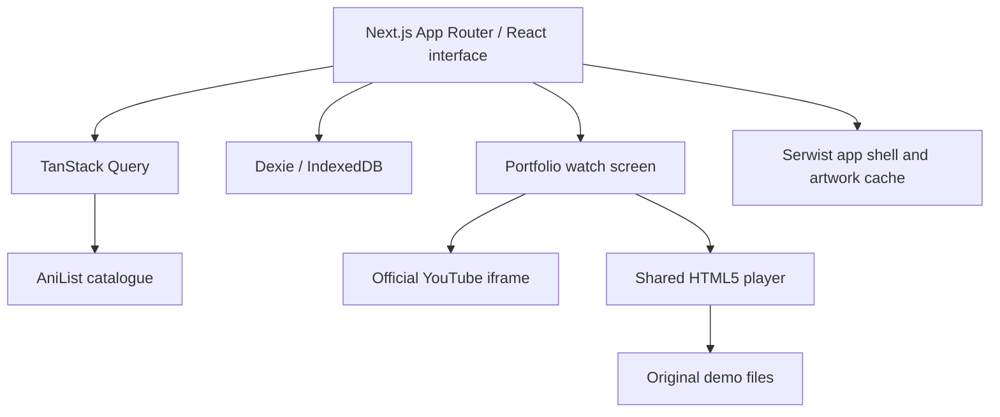

<div align="center">
  
  <h1>MaximAnim</h1>
  <p><strong>Keep your place. Find your next story.</strong></p>
  <p>An anime library, tracker and video player, built for the way a phone is actually used.</p>
</div>


**[Live Demo](#try-it)** · [Screenshots](#a-look-inside) · [Run locally](#run-locally) · [My YouTube channel](https://www.youtube.com/@booogiepopp)

I built MaximAnim around a small daily loop: find something, save it, watch a little, and come back exactly where you left off. It has a quiet black interface, pink accents, artwork-aware colors and navigation designed for a thumb. The desktop version uses a left rail and gives the same content room to breathe.

This repository is the **portfolio edition**. Anime pages are a catalogue; playback demonstrates my travel vlogs through YouTube’s official player, or an original short through MaximAnim’s own HTML5 player. **It does not stream anime episodes.** The separate personal application and its playback integrations are not part of this repository.

## Try it

[Open MaximAnim](https://maximanim-portfolio.vercel.app). This is a separate portfolio deployment. The application is also fully usable locally with no account, API key or environment file.

Your lists and viewing progress stay in this browser. Use a separate browser profile for a clean demo; clearing site storage removes that profile’s local library.

## A look inside


| Home | Search | Anime |
| --- | --- | --- |
| [](docs/images/home.webp) | [](docs/images/search.webp) | [](docs/images/anime.webp) |

| Player | Library | Desktop |
| --- | --- | --- |
| [](docs/images/player.webp) | [](docs/images/library.webp) | [](docs/images/desktop.webp) |

These are captures of the running portfolio application, using live AniList responses and a fresh demonstration library. The phone frames are stylized hardware compositions. The screens were not redrawn. They are browser captures at 393 × 852 CSS pixels, not evidence of testing on a physical iPhone.

## What you can do

- Search the anime catalogue, explore seasons and move between related works.
- Open detailed anime pages, credits, studios, people and filmographies.
- Keep local lists, mark watched episodes and follow upcoming releases in the calendar.
- Resume a demonstration from the home screen with its saved position.
- Use the same interface on a phone or desktop, with English and French catalogue navigation.
- Install the PWA and retain local library data between visits. Catalogue discovery still needs a connection.

## Two real video experiences

**Travel vlogs.** My [Boogiepop channel](https://www.youtube.com/@booogiepopp) includes trips around Japan. A new episode demonstration chooses from a small owner-approved catalogue; the choice is kept with that episode’s local resume state. Pause, seek and reload do not reroll it. Playback uses the official YouTube IFrame Player API, with YouTube’s controls, branding and restrictions intact. No stream is extracted, downloaded or proxied.

The three initial entries are [Hokkaido Road Trip](https://www.youtube.com/watch?v=p58g3idAiqc), [Kagoshima & Kumamoto](https://www.youtube.com/watch?v=78l6NygYXJY) and [Tomogashima & Shirahama](https://www.youtube.com/watch?v=n1shV0VoBnQ). Channel identity, official oEmbed responses and public player metadata were checked on 17 October 2026. Hokkaido was played and paused on the HTTPS demo with YouTube’s real controls. Availability can still differ by video and context: a local integration returned error 150. When YouTube refuses a video, the app switches to the original short and explains why; restrictions are never bypassed.

**The custom player.** [Le dernier bug — une histoire de 59 pixels](public/demo-media/last-bug.mp4) is a 20-second original short made from text, geometric graphics and synthesized audio, released under CC0. It exercises the actual HTML5 player: play/pause, timeline, seeking, progress, resume and fullscreen. H.264/AAC and WebM versions together weigh about 0.4 MB. It is intentionally labelled as demo media. Its generator is included; regenerating it requires ffmpeg, while ordinary installation uses the committed video files.

To replace the vlog catalogue, edit `src/lib/portfolio/demo.ts` with videos you own and have permission to embed. To supply original video files later, host them over HTTPS, verify redistribution rights and range requests, and replace the HTML5 sources in `src/features/player/WatchScreen.tsx`. Large originals belong in media/object storage, not Git. YouTube URLs must stay in the official iframe path.

## Built around continuity

IndexedDB, accessed through Dexie, is the local source of truth. Library edits do not depend on an account or a server write. The player saves on pause, seek, backgrounding and navigation, with throttled updates during playback. The two demo backends retain their own media identity; a selected vlog is not confused with an anime episode file.

TanStack Query caches catalogue data by identity. Warm poster remounts reuse a bounded URL presentation record instead of restarting an opacity fade. Planning restores its selected season before mounting the catalogue. New images still have an intentional reveal, and a new anime identity does not borrow the previous season’s artwork. No decoded image buffers or complete page trees are retained indefinitely.

The PWA preserves safe-area padding, ordinary document scrolling and native iOS video fullscreen. A known standalone iPhone startup issue can still shift the browser’s visual viewport on the first scroll. There is no hard-coded 59px compensation or synthetic scroll. Browser emulation is not presented as proof that this platform issue is fixed.

## Architecture



The authoring project shares the interface through a dependency-checked source export. It supplies public-only app initialization, settings, episode data and playback before compilation. The exported project has **only `/api/health` and `/api/version`**; the personal edition’s providers, extension runtime, account initialization and playback relay routes are absent from its source and build. This repository starts with a new history, rather than copying the personal repository’s commits.

| Layer | Technologies |
| --- | --- |
| Application | Next.js 16, React 19, strict TypeScript |
| Interface | Tailwind CSS 4, Archivo, Lucide |
| Catalogue and state | AniList GraphQL, Zod, TanStack Query |
| Local data | Dexie and IndexedDB |
| Video | HTMLVideoElement, hls.js in the shared player, YouTube IFrame API |
| PWA | Serwist, web app manifest, safe-area-aware layout |
| Validation | Vitest and targeted Playwright runs in the authoring project |

## Quality and current limits

The authoring branch passed 1,763 local unit tests. Targeted navigation tests passed on emulated iPhone WebKit and Chromium; portfolio tests covered absent private endpoints, persistent media selection, HTML5 playback, pause, seek, save, resume, visible video geometry and Chromium fullscreen. Source and compiled-route checks are repeatable with `npm run audit:public -- --build` after building.

Those results do not establish a coverage percentage, real-device compatibility or a security certification. YouTube playback is subject to platform and rights restrictions. AniList availability/rate limits affect discovery; a cached library remains local. The public edition has no cloud sync and no TMDB credential: remote catalogue artwork is used, while private collections of promotional rasters are not redistributed. The iPhone PWA startup viewport issue remains open pending a physical-device check.

## Run locally

Use **Node.js 24** and npm. No secrets are required.

```sh
npm ci
npm run dev
```

For a production build:

```sh
npm run typecheck
npm run lint
npm test
npm run build
npm run audit:public -- --build
npm start
```

The production start script prepares Next’s standalone static assets and starts its generated server. `PORT` and `HOSTNAME` can be supplied as runtime environment variables; the default port is 3000. The public source is produced by the private authoring workflow; authoring-only regression fixtures and personal integrations are intentionally not copied into this repository.

## Deployment

Deploy this exported project as its own Next.js application. It requires no account backend or environment secrets. Vercel can build it with `npm run build`. The included multi-stage Dockerfile runs the standalone server as a non-root user on port 3000, with `/api/health` as its liveness endpoint. Docker configuration is prepared; Linux image startup has not been tested on the Windows authoring host.

Keep the public and personal editions on distinct origins. That separates their PWA installation, browser storage and service-worker scopes. Never point a public deployment at a private Supabase project or add private server routes to make a demo work.

## License and credits

Created by Maxime. Application source and identity: all rights reserved. The original demo video files are CC0 1.0. See [LICENSE](LICENSE). The original MaximAnim identity is preserved.

Catalogue data and images belong to AniList and the original rights holders. Screenshots do not relicense anime artwork. Archivo uses the SIL Open Font License; see `src/app/fonts/OFL.txt`. Lucide and npm dependencies retain their own licenses. YouTube embeds retain YouTube’s player and branding. The original short contains no third-party footage. See [third-party notices](THIRD_PARTY_NOTICES.md).

**En français :** MaximAnim est une bibliothèque et un outil de suivi d’anime, pensé pour l’iPhone. Cette édition portfolio reste utilisable sans compte et remplace la lecture d’anime par des démonstrations autorisées : mes vlogs YouTube et un court métrage original lu dans le véritable lecteur HTML5.
