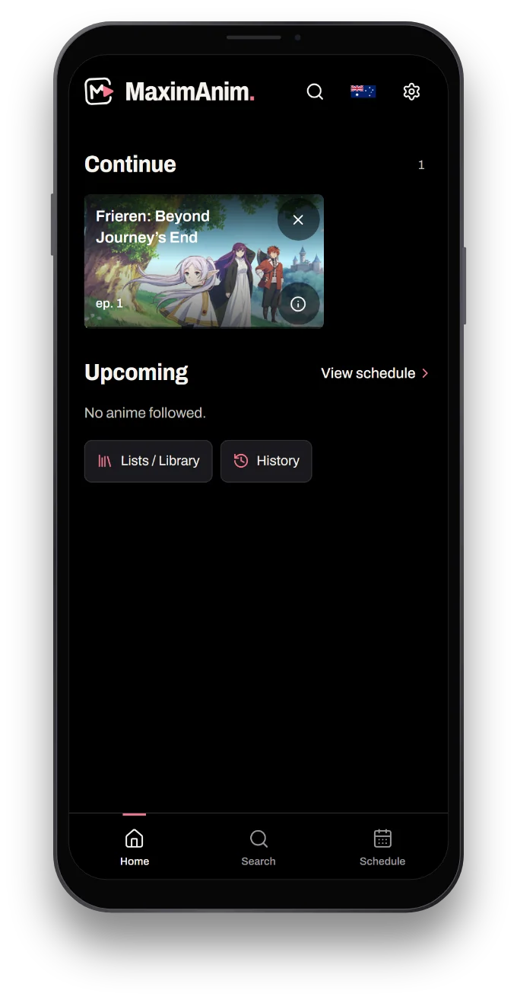

<div align="center">
  
  <h1>MaximAnim</h1>
  <p><strong>Keep your place. Find your next story.</strong></p>
  <p>An anime library and episode tracker designed for mobile, with a cinematic interface and a seamless return to what matters.</p>

  **[Live demo](https://maximanim-portfolio.vercel.app)** · **[Screenshots](#screenshots)** · **[Run locally](#run-locally)**
</div>


## The experience

Find anime, explore seasons, follow upcoming releases and pick up where you left off. MaximAnim is designed around a focused, thumb-friendly interface that adapts to desktop without losing its mobile character.

- **Discover:** catalogue search, detailed anime pages, related works, cast, staff and studios.
- **Track:** personal lists, watched episodes, progress and a calendar of upcoming releases.
- **Continue:** return to your last viewing position without losing your place.
- **Explore:** responsive layouts, artwork-aware colours, carefully considered transitions and installable PWA support.
- **Demo playback:** the public edition uses authorised personal travel videos instead of anime footage. No anime streaming sources or private provider integrations are included.

## Screenshots


| Home | Search | Anime |
| --- | --- | --- |
|  |  |  |

| Player | Library | Desktop |
| --- | --- | --- |
|  |  |  |

*Screenshots are captured from the real portfolio build at a 393 × 852 CSS-pixel viewport and placed in stylized device frames; they are not physical-device test evidence.*

## Built with

| | |
| --- | --- |
| Frontend | Next.js 16, React 19, TypeScript, Tailwind CSS 4 |
| Catalogue | AniList GraphQL, Zod, TanStack Query |
| Local-first data | Dexie / IndexedDB |
| Video demo | Official YouTube IFrame Player API |
| PWA | Serwist, responsive layout and iOS safe-area support |
| Quality | Vitest, Playwright and source/build separation checks |

The portfolio is an independent, public-safe edition with fresh Git history. The personal playback providers, private API routes, extension runtime and credentials are **not** part of this build. Library data stays in the visitor's browser; catalogue discovery needs an internet connection.

## Run locally

Requires Node.js 24 and npm. No API keys or account are needed.

```bash
npm ci
npm run dev
```

For production and verification:

```bash
npm run typecheck
npm run lint
npm test
npm run build
npm run audit:public -- --build
npm start
```

Deployment supports Next.js hosting or the included standalone Dockerfile. The public build exposes only health/version API routes.

## Notes & credits

The public edition demonstrates the player interface with authorised videos; it does **not** provide anime episodes. Third-party catalogue information and artwork belong to their respective rights holders. See [third-party notices](THIRD_PARTY_NOTICES.md) and [license information](LICENSE). Application code and branding are currently all rights reserved.

The installed iPhone PWA may still exhibit an iOS WebKit viewport shift at startup; this is documented, not claimed fixed. Other browser-platform limitations can affect embedded playback.

---

*Designed and developed by Maxime. An original, independently deployable portfolio project.*
