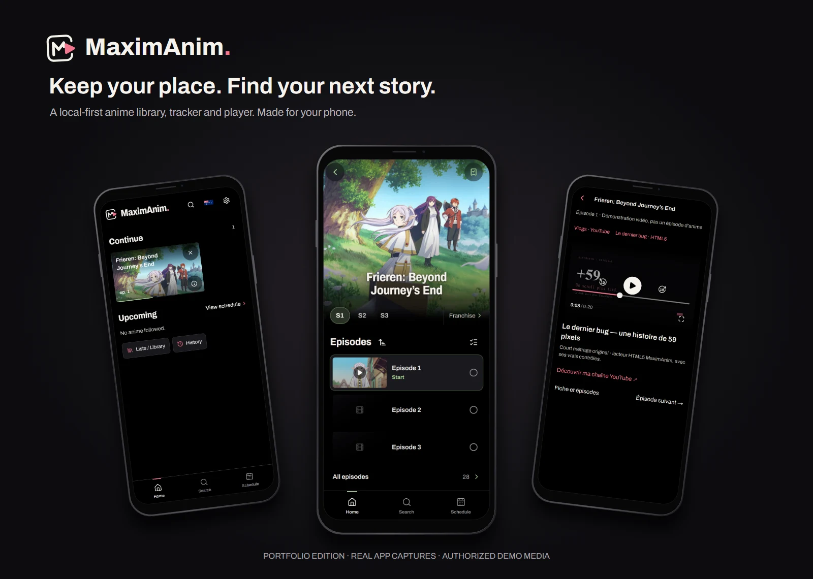
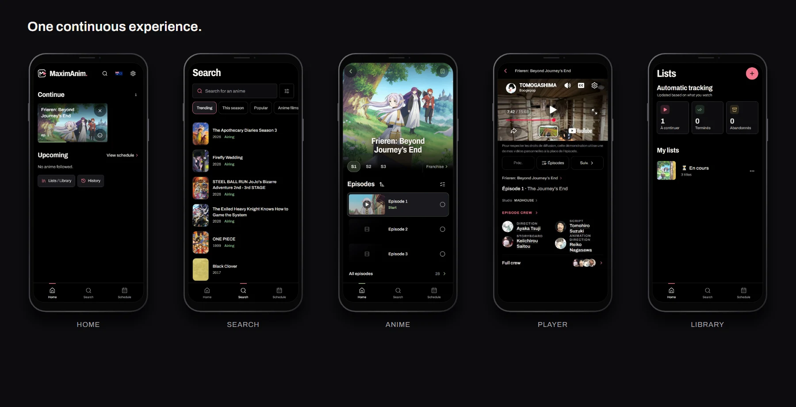
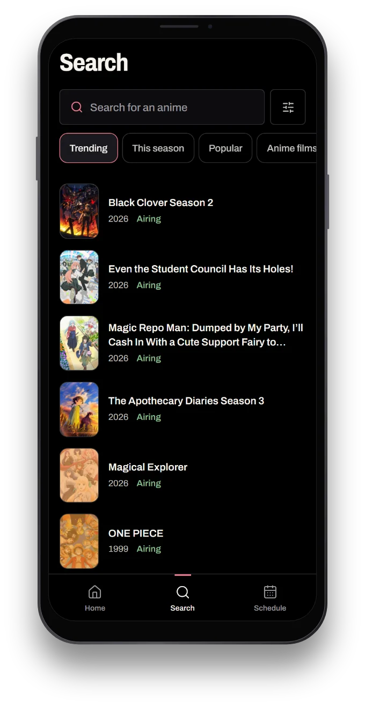
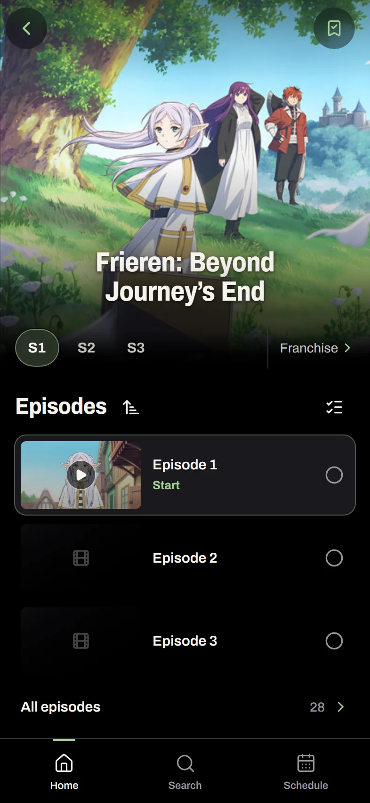
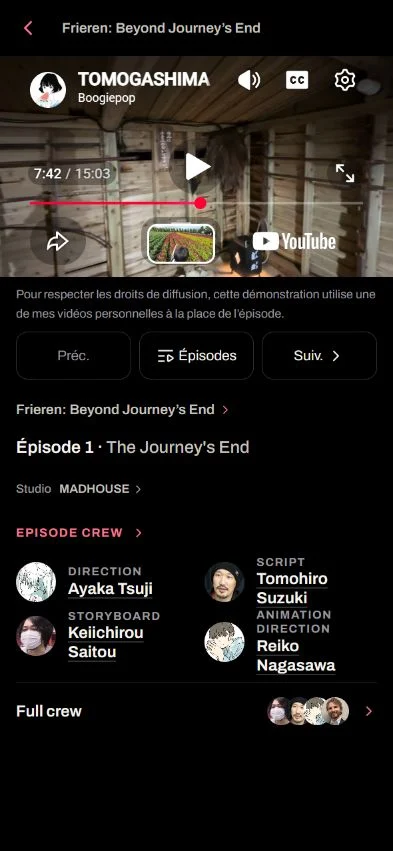
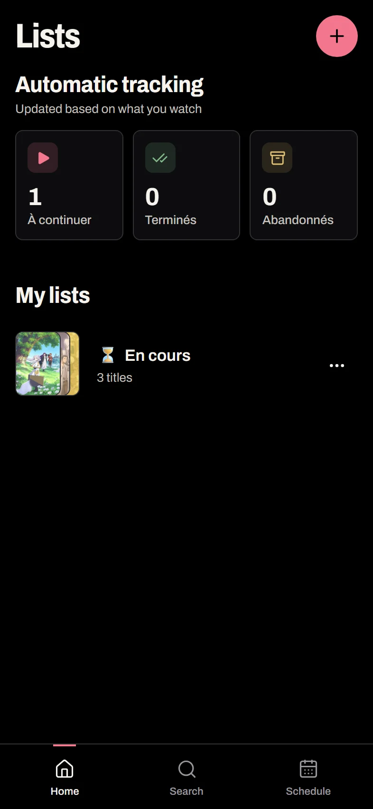
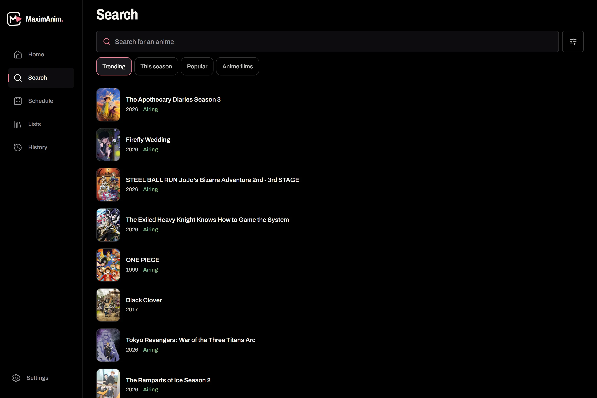

<div align="center">
  <picture>
    <source media="(prefers-color-scheme: dark)" srcset="public/brand/mark.svg">
    
  </picture>

  <h1>MaximAnim</h1>

  <p><strong>An anime library for everything between episodes.</strong></p>

  <p>
    <a href="https://maximanim-portfolio.vercel.app"><strong>Live demo</strong></a>
    &nbsp;·&nbsp;
    <a href="#screenshots">Screenshots</a>
    &nbsp;·&nbsp;
    <a href="#under-the-hood">Under the hood</a>
    &nbsp;·&nbsp;
    <a href="#run-it-locally">Run locally</a>
  </p>
</div>



## About the project

I built MaximAnim to put the things I kept doing around anime into one interface: discovering shows, exploring a season, remembering what I'd watched, and getting back to the next episode.

It started as a personal project and became a responsive web app designed around the way I use my phone. The interface keeps episode progress close to the artwork and metadata, without turning the library into a spreadsheet.

**[Explore the live portfolio edition →](https://maximanim-portfolio.vercel.app)**

## Screenshots



| Discover | Explore |
| :---: | :---: |
|  |  |
| Search by title, browse the catalogue and open related works. | Move through seasons, episodes, studios and credits. |

| Watch | Keep track |
| :---: | :---: |
|  |  |
| Start a demo video, pause it and return to your place. | Keep lists and watched episodes in your own browser. |

**Desktop, too.** The same catalogue and library adapt to a wider layout with a separate navigation rail.



*All UI screenshots come from the running portfolio build, not redesigned mock screens. The screens were captured at 393 × 852 CSS pixels and placed in stylized phone frames.*

## What it does

- **Discover anime.** Search AniList's catalogue, browse seasonal releases and follow related works, people and studios.
- **Follow episodes.** Track watched episodes and resume position. Upcoming releases appear in the calendar.
- **Keep a library.** Organise your titles and progress locally, even without signing in.
- **Use it on different screen sizes.** The responsive interface works in a browser and can be installed as a PWA. Catalogue requests still require a connection.

## A real interface, a different video

This is the **public portfolio edition** of MaximAnim. Its catalogue and episode tracking work, but it doesn't distribute or stream anime episodes.

A watch page plays one of three of my own travel videos through YouTube's official embedded player, in place of the episode. Each new viewing picks one of them at random. Reloading, coming back with the browser's Back button or resuming from **Continue** keeps the video you were watching and your position. If YouTube refuses an embed, the page tries the other two once, then offers a retry. Embedding restrictions still apply.

The personal edition is developed separately. Private playback providers, extension code, account integrations and relay endpoints are **not present** in this public repository or its build.

## Under the hood

- **App:** Next.js 16, React 19, strict TypeScript
- **UI:** Tailwind CSS 4, Lucide, responsive layouts
- **Catalogue:** AniList GraphQL, validated with Zod, cached with TanStack Query
- **Local data:** Dexie / IndexedDB
- **Demo playback:** YouTube IFrame Player API
- **PWA:** Serwist
- **Validation:** Vitest, targeted Playwright tests, an audit of the public build

Three decisions shaped the project:

**Local-first tracking.** Lists and watched episodes live in IndexedDB. Reading your library doesn't depend on logging in or on a server being available.

**Navigation continuity.** AniList responses are cached by identity, and previously presented artwork is handled differently from images appearing for the first time. Returning to a season or anime page shouldn't feel like starting it over.

**Separate public and personal builds.** The portfolio is exported with an independent Git history and a restricted set of source files and API routes. Removing the private integrations from the build matters more than hiding their buttons.

## Run it locally

You'll need **Node.js 20.9 or newer** (the Docker image runs Node 24) and npm. No account, environment file or API keys are required.

```bash
git clone https://github.com/LeBoogiepop/maximanim-portfolio.git
cd maximanim-portfolio
npm ci
npm run dev
```

Then open **http://localhost:3000**.

To check and run a production build:

```bash
npm run typecheck
npm run lint
npm test
npm run build
npm run audit:public -- --build
npm start
```

The repository also includes a standalone Dockerfile. The public build serves health/version API routes only; it doesn't require the personal application's server.

## Notes

The portfolio edition stores its lists and progress in your browser; clearing site data will erase that local copy. AniList data and third-party artwork remain subject to their original rights and availability.

The installed iPhone PWA has a documented WebKit viewport issue at startup that is still under investigation. Browser-based testing is not presented as proof of physical iPhone compatibility.

Source code and the MaximAnim identity are currently **all rights reserved**. See [LICENSE](LICENSE) and [third-party notices](THIRD_PARTY_NOTICES.md) for the applicable terms and credits.

---

<p align="center"><sub>Designed and developed by Maxime.</sub></p>
